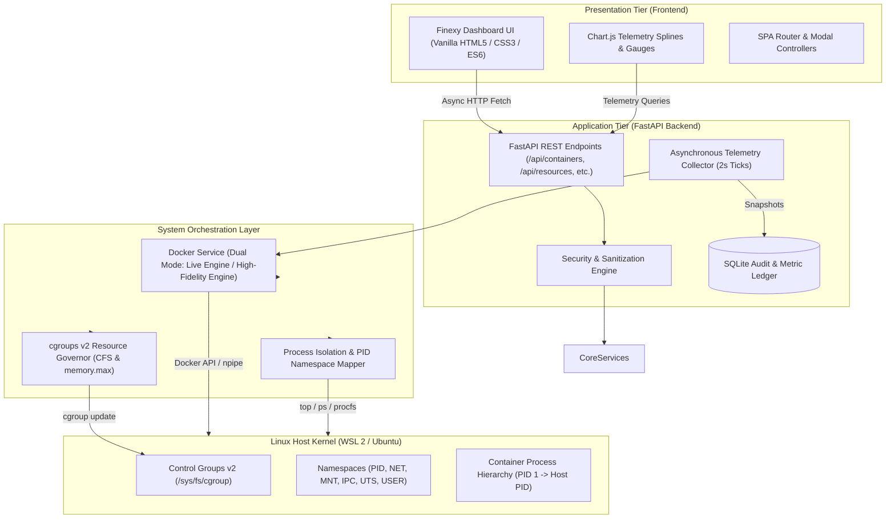

# NEXORA System Architecture

**Linux Container-Based Process Isolation and Resource Management Platform**  
*Isolate. Monitor. Optimize.*

---

## 1. Architectural Overview

NEXORA is an enterprise-grade platform designed to demonstrate, monitor, and enforce Linux process isolation and cgroups hardware resource boundaries.

Unlike traditional hypervisor-based Virtual Machines (VMs) which emulate physical hardware and run redundant guest operating system kernels, NEXORA leverages native Linux kernel features:
1. **Namespaces** (`CLONE_NEW*` flags): Virtualizes kernel resources (PID trees, network interfaces, filesystem mount hierarchies, IPC, hostnames, user mappings).
2. **Control Groups (cgroups v2)**: Restricts, prioritizes, and accounts hardware resources (CPU CFS quotas, memory.max boundaries, I/O bandwidth, max PIDs).
3. **Docker Engine & Docker SDK for Python**: Programmatically commands the container runtime daemon.
4. **FastAPI & SQLite**: High-performance asynchronous API tier and persistent audit/telemetry ledger.
5. **Modern Vanilla Frontend**: Finexy-inspired SaaS user interface with Chart.js and Lucide icons.

---

## 2. Linux Kernel Process Isolation (Namespaces)

NEXORA provides interactive inspection of the 7 core Linux namespaces:

| Namespace | Clone Flag | Virtualized Resource | Isolation Impact |
|:---|:---|:---|:---|
| **PID** | `CLONE_NEWPID` | Process IDs | Main container process becomes PID 1 inside the container; on the host kernel it maps to an unprivileged PID (e.g., 28410). Prevents container processes from seeing or signaling host processes. |
| **NET** | `CLONE_NEWNET` | Network devices, IP routing, firewall tables | Containers receive dedicated virtual ethernet pairs (`veth`) attached to the `docker0` bridge. Port sniffing is isolated. |
| **MNT** | `CLONE_NEWNS` | Mount points and filesystem hierarchy | Combined with `pivot_root` and OverlayFS, isolates container root filesystem (`/`) from host paths. |
| **IPC** | `CLONE_NEWIPC` | System V IPC & POSIX message queues | Prevents shared-memory eavesdropping between container processes. |
| **UTS** | `CLONE_NEWUTS` | Hostnames and NIS domain names | Allows each container to maintain its own unique hostname without impacting host OS. |
| **USER** | `CLONE_NEWUSER` | UID and GID mapping | Maps container root (UID 0) to unprivileged host UIDs (e.g., UID 100000). |
| **CGROUP** | `CLONE_NEWCGROUP` | Cgroup hierarchy views | Masks host cgroup root directory from `/proc/self/cgroup`. |

---

## 3. Control Groups v2 (cgroups) Resource Enforcement

NEXORA interacts directly with Linux cgroups v2 subsystems:

### CPU Bandwidth Quota (Completely Fair Scheduler - CFS)
- **Period (`cpu.cfs_period_us`)**: Standard cycle window (typically $100{,}000\ \mu\text{s} = 100\ \text{ms}$).
- **Quota (`cpu.cfs_quota_us`)**: Maximum CPU runtime allowed within each period:
  $$\text{Quota} = \text{Allocated Cores} \times 100{,}000\ \mu\text{s}$$
  *Example:* A $1.5\text{-core}$ limit enforces $\text{quota} = 150{,}000\ \mu\text{s}$ per $100{,}000\ \mu\text{s}$ period.
- **Docker SDK Parameter**: `nano_cpus` ($10^9 \times \text{cores}$).

### Memory Limits & Out-Of-Memory (OOM) Protection
- **Hard Limit (`memory.max`)**: In bytes ($M \times 1024 \times 1024$).
- **Working Set Calculation**:
  $$\text{Working Memory} = \text{Usage} - (\text{Inactive File Cache})$$
- **OOM Protection**: Generates high-utilization alerts ($>85\%$) prior to kernel OOM killer invocation.
- **Dynamic Updates**: Modifies running containers in real-time using `container.update(nano_cpus=..., mem_limit=...)`.

---

## 4. Telemetry Pipeline & Docker CPU Delta Formula

Docker's raw stats API provides cumulative counter values. NEXORA calculates instantaneous CPU utilization percentage across online CPU cores via the standard Linux container formula:

$$\Delta\text{cpu} = \text{cpu\_usage.total\_usage}_{t} - \text{cpu\_usage.total\_usage}_{t-1}$$
$$\Delta\text{system} = \text{system\_cpu\_usage}_{t} - \text{system\_cpu\_usage}_{t-1}$$
$$\text{CPU Percent} = \left(\frac{\Delta\text{cpu}}{\Delta\text{system}}\right) \times N_{\text{cpus}} \times 100\%$$

Snapshots are ingested by the background collector every 2 seconds, archived in the SQLite database, and made accessible for historical analytics.
